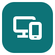

<p align="center">
  
</p>

# LinkToLinux

Connect your Android phone to Linux over Wi-Fi. Send files, browse photos, share your camera and microphone, and sync your clipboard.

[Download for Linux](https://github.com/prawinin/linktolinux/releases/download/v1.0.0/LinkToLinux-1.0.0-linux-x86_64.run) · [Download for Android](https://github.com/prawinin/linktolinux/releases/download/v1.0.0/LinkToLinux-Companion.apk)

## Get started

Download the Linux installer and run it:

```sh
chmod +x LinkToLinux-1.0.0-linux-x86_64.run
./LinkToLinux-1.0.0-linux-x86_64.run
```

Open **LinkToLinux** from your applications menu. The installer includes the Android companion, which you can download to your phone using the QR code in **Connection**. You can also install the APK from the link above.

Put both devices on the same Wi-Fi. In the Android app, enter the desktop address, port and pairing code shown on Linux. Leave **Remember this desktop** enabled to reconnect automatically. Grant the permissions for the features you want to use.

If your phone stops the app in the background, open **Background settings** and allow **Unrestricted** battery use or **No restrictions**. Some phones also require background activity or autostart permission.

## Features

- **Files:** drag files into the Linux app, choose **Send files**, or share to LinkToLinux from another Android app. Received files go to `Downloads/LinkToLinux`. Existing files are kept. Transfers show progress and can be cancelled.
- **Photos:** browse your phone’s photos and save originals to Linux. Android may limit access to selected photos.
- **Camera:** use the front or back camera, rotate the picture, and send it to a virtual webcam.
- **Microphone:** use your phone as a PipeWire audio source. Select `linktolinux_mic` in your recording or meeting app.
- **Clipboard:** copy text between devices. Android only allows clipboard reads while the companion is open; its notification has a **Send clipboard** shortcut.
- **ADB tools:** view the phone screen, navigate and take screenshots with USB or wireless debugging enabled.

Keep the Android app visible when starting camera or microphone sharing. Once capture starts, you can switch apps. Stop sharing from either device or the phone notification. Capture stops when the connection is lost and must be started again manually.

File transfers support up to 16 files per batch and 8 GiB per file. Zip folders before sending. Photo downloads support images up to 20 MiB. Interrupted transfers must be sent again. On Android 7–9, force-stopping the app during receipt can leave a partial file; delete it before retrying.

## Requirements

| Platform | Requirements |
| --- | --- |
| Linux | x86_64, glibc 2.34+, GTK 3, WebKitGTK 4.1 and a graphical desktop |
| Installer | Python 3.10+ |
| Android | Android 7+ |

The Linux app has been tested on EndeavourOS with GNOME.

Install the tools needed for the features you use:

| Feature | Linux tools |
| --- | --- |
| Camera preview | `ffmpeg` |
| Virtual webcam | `v4l2loopback` built for your running kernel |
| Microphone | PipeWire, PulseAudio compatibility, `pactl`, `pw-cat`, `ffmpeg` |
| Clipboard | Built-in desktop clipboard access; `wl-clipboard` or `xclip` can be used as a fallback |
| ADB tools | `adb` |

For virtual webcam output, choose **Connection → Enable virtual webcam**, then restart camera sharing. Select **LinkToLinux Camera** in the receiving app. Loading the driver requires administrator authorization.

## Updates and removal

Close the app and run a newer installer to update. Pairing, preferences and received files are kept. Update Android by installing the new companion APK.

To remove the Linux app, choose **Uninstall** from its application-menu actions, or run:

```sh
python3 "${XDG_DATA_HOME:-$HOME/.local/share}/linktolinux/uninstall.py" --uninstall
```

Uninstalling keeps your pairing, preferences and received files.

## Troubleshooting

- **Cannot connect:** check the address, port and pairing code, and allow the displayed TCP port through your firewall. Guest Wi-Fi may block communication between devices.
- **No photos:** grant photo access on Android, then choose **Refresh photos** on Linux.
- **Camera or microphone will not start:** open the Android app, check permissions and close other apps using the camera or microphone.
- **Camera preview works, but other apps cannot see it:** enable the virtual webcam, check device permissions and restart camera sharing.
- **Clipboard is not syncing:** check that sync is enabled in both apps and copy some text. Empty selections and images are not sent automatically. Open the companion to send phone clipboard text.

**Disconnect** pauses automatic reconnection. **Connection → Reset pairing** revokes the saved pairing and requires pairing again. Android’s **Force stop** stops the companion until you reopen it.

## Privacy

Your phone and desktop communicate directly. There are no accounts, cloud relays, analytics or ads.

The local connection is authenticated but **not encrypted**. Use trusted private Wi-Fi and do not expose the listener to the internet.

## License

Free for personal, non-commercial use under the [Personal Use License](LICENSE). Commercial use and redistribution require written permission. [Third-party software](THIRD_PARTY_NOTICES.md) retains its own licenses.

See [BUILDING.md](BUILDING.md) to build from source.
